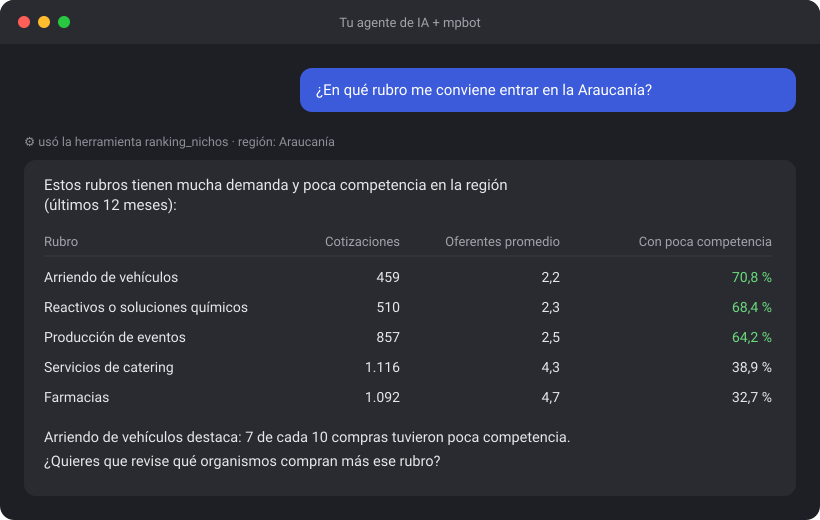
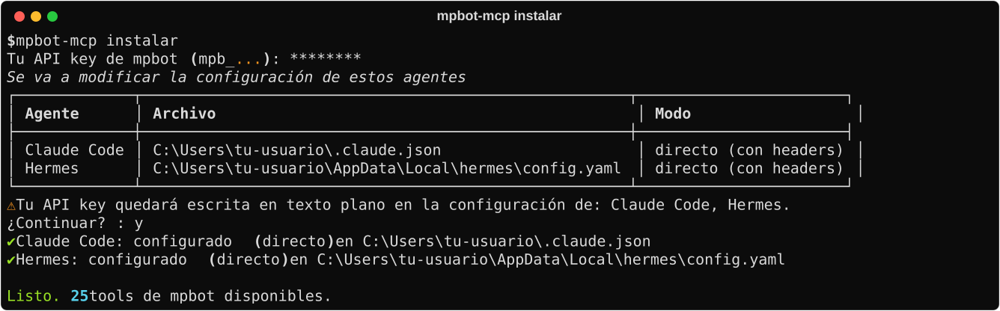
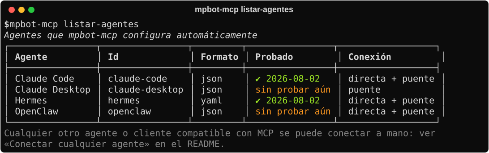

# mpbot-mcp

**Los datos de Compra Ágil de Mercado Público, dentro de tu asistente de IA.**

Conecta tu asistente de IA (Claude, Hermes, OpenClaw, Cursor o cualquiera
compatible con MCP) a [mpbot](https://mpbot.cl). Después le preguntas en
lenguaje normal y te responde con datos reales de Compra Ágil.



---

## ¿Qué necesitas?

1. **Una cuenta en mpbot** con un plan que incluya acceso MCP.
2. **Tu API key** (te explicamos abajo cómo obtenerla).
3. **Un asistente de IA** que soporte MCP.
4. **Python 3.12 o superior**, solo si vas a usar el instalador automático.

---

## 1. Obtén tu API key

1. Entra a [app.mpbot.cl/config](https://app.mpbot.cl/config) con tu cuenta.
2. En la sección **API Keys**, crea una key nueva. Empieza con `mpb_`.
3. Cópiala y guárdala en un lugar seguro.

Si la pierdes o crees que alguien más la tiene, revócala ahí mismo y crea otra.

---

## 2. Conecta tu asistente

Hay dos caminos. Elige el que te acomode.

### Opción A: instalador automático (recomendado)

```bash
pip install git+https://github.com/ssolis-ti/mpbot_mcp.git
mpbot-mcp instalar
```

El instalador busca los asistentes que tienes en tu equipo, te pide la API
key, valida que funcione y los deja conectados. Antes de tocar cualquier
archivo te muestra qué va a cambiar y guarda un respaldo.



Estos son los asistentes que reconoce solo:



¿El tuyo no aparece? Usa la opción B.

### Opción B: conectar cualquier agente

mpbot es un servidor MCP estándar. Cualquier asistente o programa compatible
con MCP se conecta con estos dos datos:

| Dato | Valor |
|---|---|
| Dirección | `https://app.mpbot.cl/mcp/` |
| Autorización | `Authorization: Bearer mpb_TU_API_KEY` |

En la mayoría de los asistentes eso se escribe así en su archivo de
configuración MCP:

```json
{
  "mcpServers": {
    "mpbot": {
      "type": "http",
      "url": "https://app.mpbot.cl/mcp/",
      "headers": { "Authorization": "Bearer mpb_TU_API_KEY" }
    }
  }
}
```

**Si tu asistente solo acepta programas locales** (no direcciones web), instala
el paquete, guarda tu key una vez con `mpbot-mcp instalar` y configúralo así:

```json
{
  "mcpServers": {
    "mpbot": { "command": "mpbot-mcp", "args": ["servir"] }
  }
}
```

De esta forma la API key no queda escrita en la configuración del asistente.

---

## 3. Pregúntale a tu asistente

Habla como hablarías con una persona. Algunos ejemplos:

- *"¿En qué rubro me conviene entrar en la Región de Valparaíso?"*
- *"¿Cómo está el mercado de neumáticos en Aysén?"*
- *"¿Quién me está ganando las compras de servicios de aseo?"*
- *"¿Qué organismos deberían volver a comprar artículos de oficina pronto?"*
- *"Vendo computadores, ¿en qué más podría vender?"*
- *"¿Qué tan caro puedo cotizar y aun así ganar en catering?"*

Tu asistente elige solo qué herramientas usar.

---

## Herramientas disponibles

Tu asistente recibe estas herramientas al conectarse. Si mpbot agrega una
nueva, aparece sola, sin actualizar nada.

### Para empezar

| Herramienta | Para qué sirve |
|---|---|
| `buscar_rubro` | Encuentra el rubro (código UNSPSC) a partir de un nombre. |
| `buscar_producto` | Encuentra rubros a partir de un producto real, aunque ningún rubro se llame así. |
| `listar_regiones` | Muestra los nombres de las 16 regiones que se pueden usar como filtro. |
| `estado` | Indica hasta qué fecha llegan los datos. |

### Descubrir qué vender

| Herramienta | Para qué sirve |
|---|---|
| `ranking_nichos` | Rubros con mucha demanda y poca competencia en una región. |
| `oportunidades_pyme` | Ideas de negocio para una pyme chica, sin tener que nombrar un rubro. |
| `ranking_crecimiento` | Rubros que crecen o caen comparado con el año anterior. |
| `ranking_desercion` | Rubros donde los organismos compran pero muchas veces nadie gana. |
| `nichos_adyacentes` | Otros rubros donde venden los mismos proveedores de un rubro. |

### Conocer un mercado

| Herramienta | Para qué sirve |
|---|---|
| `mercado_rubro` | Demanda mes a mes, montos y precios ganadores de un rubro. |
| `resumen_mensual` | Cómo le fue a un rubro el último mes comparado con el anterior. |
| `oportunidades` | Organismos que compran el rubro y tienen poca competencia. |
| `demanda_esperada` | Organismos que probablemente vuelvan a comprar pronto. |
| `primera_apuesta` | Las compras más fáciles para partir: poca competencia, montos bajos y recurrentes. |
| `tasa_desercion` | Qué porcentaje de las compras de un rubro quedó sin adjudicar. |
| `licitaciones_desiertas` | Listado de compras concretas que quedaron sin adjudicar. |

### Entender la competencia

| Herramienta | Para qué sirve |
|---|---|
| `competidores_rubro` | Quiénes ofertan en un rubro y cuánto ganan. |
| `perfil_competencia` | Si un rubro lo dominan las pymes o las empresas grandes. |
| `perfil_proveedor` | Historial de un proveedor por RUT: ofertas, adjudicaciones y montos. |
| `perfil_organismo` | Qué compra un organismo, cuánto y en qué meses. |
| `ventaja_local` | Si conviene vender en tu propia región o da lo mismo dónde. |

### Decidir cómo cotizar

| Herramienta | Para qué sirve |
|---|---|
| `curva_precio` | Qué tan probable es ganar según qué tan caro cotizas. |
| `backtest_rubro` | Qué habría pasado mes a mes cotizando siempre en un rango de precio. |
| `cohorte_entrantes` | Qué les pasó a quienes empezaron a vender en ese rubro. |
| `curva_perseverancia` | Cuántos intentos suele tomar ganar la primera vez. |

Casi todas aceptan una región para filtrar los resultados.

---

## Comandos

| Comando | Qué hace |
|---|---|
| `mpbot-mcp instalar` | Conecta tus asistentes a mpbot. |
| `mpbot-mcp doctor` | Revisa paso a paso qué falla y te dice cómo arreglarlo. |
| `mpbot-mcp listar-agentes` | Muestra los asistentes que el instalador reconoce. |
| `mpbot-mcp servir` | Conexión local para asistentes que solo aceptan programas locales. Lo inicia el asistente. |

---

## ¿Algo no funciona?

Ejecuta:

```bash
mpbot-mcp doctor
```

Revisa tu key, la conexión, tu plan, tu cuota y tus asistentes, y te dice en
simple qué hacer. Los casos más comunes:

| Mensaje | Qué hacer |
|---|---|
| La API key no sirve o fue revocada | Crea una nueva en [app.mpbot.cl/config](https://app.mpbot.cl/config). |
| Tu plan no incluye acceso al servidor MCP | Revisa tu plan en [app.mpbot.cl/config](https://app.mpbot.cl/config). |
| Se agotó la cuota mensual | Se renueva al inicio del próximo ciclo. |
| No se pudo contactar al servidor | Revisa tu conexión a internet o tu proxy. |

---

## Tu API key está protegida

- Se guarda en un solo archivo que solo tu usuario puede leer.
- Nunca se muestra completa en pantalla.
- Antes de modificar la configuración de un asistente, se guarda un respaldo.

---

## Enlaces

- Sitio: [mpbot.cl](https://mpbot.cl)
- Aplicación y API keys: [app.mpbot.cl](https://app.mpbot.cl)

## Licencia

[MIT](LICENSE)
